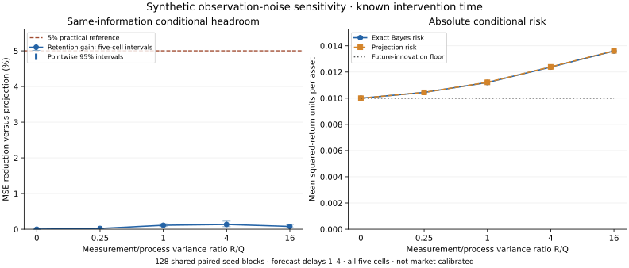

# Observation-noise sensitivity: all five declared cells

This is a synthetic, known-intervention-time sensitivity study, informed by prior experiments. It is not market calibration or optimisation of a chosen setting. The complete five-cell grid and the new 128 seed blocks were fixed before the run; no fitted model or parameter tuning was introduced.

Engineering, mathematical and statistical subagents reviewed the design. The engineering subagent implemented the runner and fixture tests; root integrated plotting and reporting. The experiment runtime and plotting runtime are separate.

## Conditional headroom

Each quantity first averages four delayed forecast origins and both event worlds within a seed. Reported fractions are ratios of pooled means. The same 128 paired seed blocks and bootstrap indices span every cell; neither cells nor worlds multiply independent sample size.

| R/Q variance ratio | Bayes risk | Projection risk | Retention gain | Five-cell interval | Category-oracle headroom | Future-noise share | Perfect-state ceiling |
| --- | ---: | ---: | ---: | --- | ---: | ---: | ---: |
| 0 | 0.01000000 | 0.01000000 | 0.0000% | [0.0000%, 0.0000%] | 0.000% | 100.00% | 0.00% |
| 0.25 | 0.01044211 | 0.01044438 | 0.0217% | [0.0160%, 0.0283%] | 0.025% | 95.77% | 4.25% |
| 1 | 0.01119863 | 0.01121114 | 0.1116% | [0.0756%, 0.1528%] | 0.283% | 89.30% | 10.80% |
| 4 | 0.01237453 | 0.01239117 | 0.1342% | [0.0730%, 0.2274%] | 1.610% | 80.81% | 19.30% |
| 16 | 0.01360488 | 0.01361555 | 0.0784% | [0.0408%, 0.1348%] | 2.793% | 73.50% | 26.55% |

The primary intervals are 99% individual percentile intervals (Bonferroni alpha=.05/5), using 9,999 paired seed resamples with seed 789012. Their joint coverage is approximate. The fractions other than retention gain have descriptive 95% intervals in the summary. Conditional Bayes optimality is assumed by the correctly specified model; the empirical issue is effect size, not a new theorem.

Cells whose entire adjusted retention-gain interval exceeds the 5% practical reference: **none**. This reports the full grid and does not select an optimal cell or establish that any financial series has its assumed observation noise.

## Decision and additional mechanism ceiling

No reported cell justifies architecture expansion to obtain the promised 5% retention benefit. Gains are small throughout the complete declared grid, and the largest primary adjusted upper bound remains below the practical reference. This is a scoped result for the tested generator, timing privilege and delayed target; it is not a universal impossibility theorem.

At higher R, the perfect-current-state ceiling exceeds 5% while actual same-information retention gains remain tiny. The outcome therefore cannot be attributed solely to the future-innovation floor: the Gaussian approximation already supplies nearly the same conditional forecast means as exact inference.

A post-hoc algebraic bound derived from the complete table also limits what perfect event-category information could add. Its reduction relative to projection is 1-mean(category-oracle risk)/mean(projection risk), which combines the two differently normalised headroom fractions above. The largest observed-history value across the reported cells is **2.8691%**, still below 5%. This is a conditional expected-risk bound for these averaged histories, not a bound on realised losses or a prespecified simultaneous statistical claim.

## Absolute risk and realised losses

| R/Q | Absolute conditional projection excess | Retained realised MSE | Projected realised MSE |
| --- | ---: | ---: | ---: |
| 0 | 0.0000000000 | 0.01044509 | 0.01044509 |
| 0.25 | 0.0000022663 | 0.01094100 | 0.01094761 |
| 1 | 0.0000125113 | 0.01169809 | 0.01172565 |
| 4 | 0.0000166334 | 0.01289180 | 0.01293776 |
| 16 | 0.0000106687 | 0.01417484 | 0.01420649 |

Higher relative gain can coexist with higher absolute prediction error. Conditional risks integrate latent-state and future-innovation uncertainty, while realised MSE contains the particular sampled innovations; they need not rank methods identically on a finite sample.

## Scientific limits

Only R changes. Every method receives the true intervention time, true noise parameters, fixed dynamics, known Gaussian impulse law and the guarantee of no further events. Unknown timing, parameter error, other corruption mechanisms, overlapping events, real-market transfer, trading utility and methodological novelty are not established.

The R=0 cell is a delayed perfect-observation control, not a claim that event type stays unknowable. Once y[tau+1] reveals the exact current state, delayed forecasts agree and conditional risk equals the .01 future-noise floor. Historical type probabilities may still change; realised MSE is random. Tiny positive squared-roundoff gains and their positive numerical bootstrap bounds at R=0 are numerical zero, not a statistical signal.

Any promising synthetic cell requires external justification for its observation quality before it can motivate a market-facing project. Do not tune another architecture to the disclosed cells and call that a new test. An operational candidate selected from this study requires a separate design and fresh evaluation.

The next useful work is a concrete data and observable-target audit: establish whether recording errors and genuine shocks are separately verifiable, whether independent information is available at the prediction origin, and whether the desired horizon has useful headroom. Further synthetic settings chosen to produce positive results would not establish that justification.

## Figure

The figure shows every declared cell with the same categorical axis. The left panel displays primary headroom and uncertainty; the right displays absolute conditional risk. It does not interpolate a market-calibrated optimum.

## Provenance and reproduction

Executed model source tree: `ea5b46d35b004153384ef6044878528d8c6a6bb0`. Model runtime: Python 3.13.3, NumPy 2.3.2. Full matrices, actual source-file SHA256 values and coupling/control residuals are stored in the [summary](../results/noise-sensitivity-v1/summary.json). Local commit identity is distinguished from the public source-tree identity.

Run `python -m ripplenet.noise_sensitivity_report` to render tables from saved results. Optional figure rendering requires Matplotlib: `python -m ripplenet.noise_sensitivity_report --plot`. The figure provenance records plotting versions and input-summary hash separately; plotting does not run the simulator. Full reproduction into another directory uses `python -m ripplenet.noise_sensitivity --output work/noise-reproduction`; these then-disclosed seeds are not a new independent test.

[Declared plan](noise-sensitivity-plan.md), [mathematics](noise-sensitivity-mathematics.md), [audit plan](noise-sensitivity-audit-plan.md), [statistical review](noise-sensitivity-statistical-review.md), [engineering review](noise-sensitivity-engineering-review.md), [interpretation](noise-sensitivity-interpretation.md). No paid resources were started.
